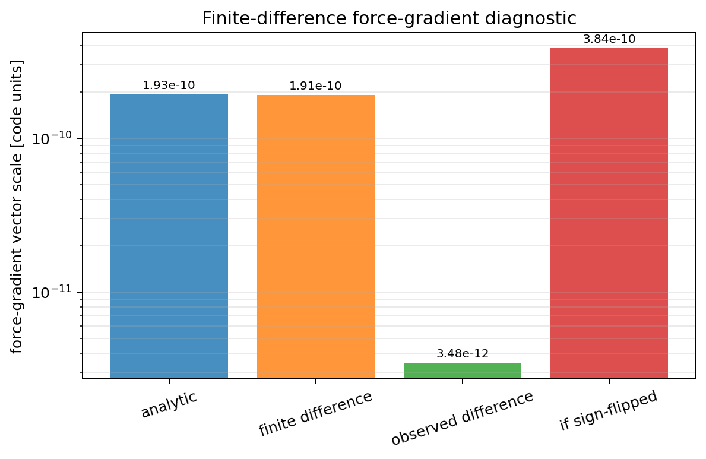
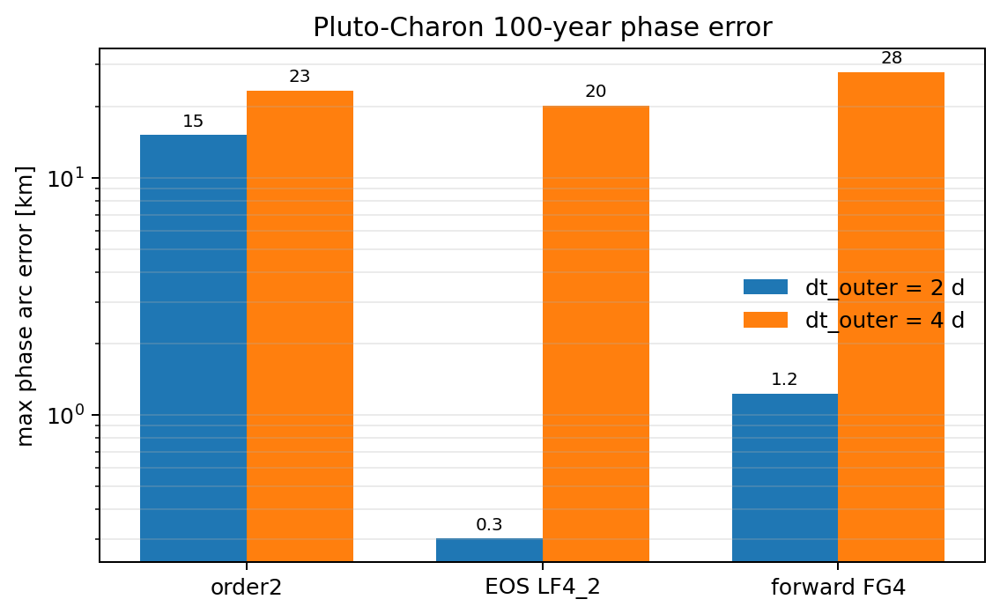
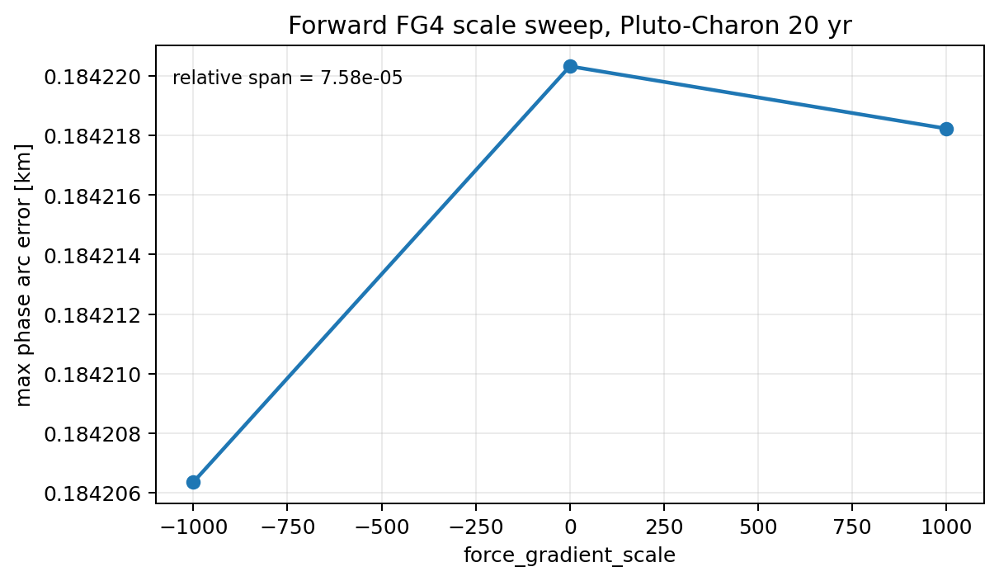

# BCH Analysis and Current Bridge Limitations

This note records the derivation path that led to the current
`rebound_bridge` design decision:

```text
The standard BCH coefficients are useful for understanding ideal Hamiltonian
splittings, but they cannot be applied directly to the current host-relative
Bridge implementation as if it were a canonical Cartesian splitting.
```

The important point is not that the Baker-Campbell-Hausdorff (BCH) formula is
wrong.  The issue is that the current engineering variables are not the same
canonical variables assumed by the standard BCH force-gradient derivations.

## 1. The Ideal BCH Setting

For a Hamiltonian split

```text
H = H_A + H_B,
```

define the Lie operators

```text
A f = {f, H_A}
B f = {f, H_B}.
```

The standard BCH calculation assumes:

```text
1. A and B are Hamiltonian vector fields on the same phase space.
2. The phase-space variables are canonical coordinates (q, p).
3. The maps exp(hA) and exp(hB) are exact flows of H_A and H_B.
4. The kinetic energy has the diagonal Cartesian form

       T = sum_i p_i^2 / (2 m_i)

   when the usual force-gradient simplification is used.
```

Under these assumptions, a composition such as

```text
S(h) = exp(hB/2) exp(hA) exp(hB/2)
```

has a well-defined shadow Hamiltonian expansion.  BCH can then be used to
derive the leading error terms and design correctors, processors, or
force-gradient kernels.

## 2. KDK Bridge BCH Expansion

Let

```text
C = [A, B]
D = [A, C] = [A, [A, B]]
E = [B, C] = [B, [A, B]].
```

For the symmetric KDK kernel

```text
S_KDK(h) = exp(hB/2) exp(hA) exp(hB/2),
```

the BCH expansion through third order is

```text
log S_KDK(h)
  = h(A + B)
  + h^3 ( (1/12) D + (1/24) E )
  + O(h^5).
```

The exact sign convention depends on whether one writes commutators as
`[A,B]` or `[B,A]`, but the structural result is unchanged:

```text
KDK contains two independent third-order error directions:

1. [A, [A, B]]
2. [B, [A, B]]
```

This explains why a plain second-order Bridge can conserve energy well while
still accumulating phase error.  The shadow Hamiltonian is nearby, but the
nearby Hamiltonian can have a biased internal frequency.

For fast subsystems such as Earth-Moon or Pluto-Charon, a tiny frequency bias
becomes a visible phase drift over long integrations.

## 3. EOS LF4_2 Derivation

The EOS LF4_2 step used by this project has the form

```text
S_EOS(h)
  = exp(a h A)
    exp(hB/2)
    exp((1 - 2a) h A)
    exp(hB/2)
    exp(a h A).
```

BCH gives

```text
log S_EOS(h)
  = h(A + B)
  + h^3 (
        ((6a^2 - 6a + 1) / 12) [A, [A, B]]
      + ((1 - 6a) / 24) [B, [A, B]]
    )
  + O(h^5).
```

EOS chooses `a` so that the `[A,[A,B]]` coefficient vanishes:

```text
6a^2 - 6a + 1 = 0.
```

The two roots are

```text
a = 1/2 +/- sqrt(3)/6.
```

The implementation uses the smaller positive root:

```text
a = 1/2 - sqrt(3)/6
  = 0.211324865405187...
```

After this choice, the remaining third-order term is only the
`[B,[A,B]]` direction:

```text
((1 - 6a) / 24) [B, [A, B]]
  = ((sqrt(3) - 2) / 24) [B, [A, B]].
```

This is why EOS LF4_2 worked better than plain KDK in the tests.  It does not
solve every phase problem, but it removes one of the two leading BCH error
directions at the operator-structure level.

## 4. Why a Simple Processor Was Not Enough

One attempted idea was to use a boundary processor of the schematic form

```text
P = exp(alpha h^2 [A, B])
```

and run

```text
P^{-1} S(h)^n P.
```

At third order, this type of processor shifts the two third-order BCH
coefficients together.  In a simplified notation, if the kernel has

```text
c_D [A,[A,B]] + c_E [B,[A,B]],
```

then this one-parameter processor produces a shift of the form

```text
(c_D + s alpha) [A,[A,B]]
+ (c_E + s alpha) [B,[A,B]],
```

up to sign convention.  The same parameter moves both coefficients along one
line in the error plane.

To eliminate both terms, one would need

```text
c_D + s alpha = 0
c_E + s alpha = 0.
```

This requires

```text
c_D = c_E.
```

For KDK,

```text
c_D = 1/12
c_E = 1/24,
```

so the two equations are inconsistent.  The processor can reduce or move the
error, but a single `[A,B]` processor cannot cancel both independent third-order
directions in the KDK kernel.

This was the first sign that the problem was structural rather than a missing
scale factor.

## 5. Forward Force-Gradient Fourth-Order Kernel

The forward force-gradient idea was then tested because it avoids Yoshida-style
negative timesteps.

The ideal force-gradient fourth-order structure is

```text
S_FG4(h)
  = exp(hB/6)
    exp(hA/2)
    exp(2hB/3 + gamma h^3 [B,[A,B]])
    exp(hA/2)
    exp(hB/6).
```

BCH gives

```text
log S_FG4(h)
  = h(A + B)
  + h^3 (0 * [A,[A,B]] + (gamma - 1/72) [B,[A,B]])
  + O(h^5).
```

Therefore the ideal exponent-level force-gradient coefficient is

```text
gamma = 1/72.
```

In the current C implementation, the code-level coefficient depends on how the
force-gradient acceleration correction is folded into the velocity kick.  The
current experimental method is implemented as `REB_BRIDGE_METHOD_FORWARD_FG4`
in `src/bridge_fg4_experimental.c` and uses the existing force-gradient
correction path in `src/bridge_force_gradient_experimental.c`.

The important result is empirical: changing the force-gradient scale over a
large range did not control the Pluto-Charon phase error.  This suggests that
the standard `[B,[A,B]]` channel is not the dominant source of the observed
phase drift in the current Bridge representation.

## 6. What the Current Bridge Actually Does

The current implementation is an engineering Bridge between separate REBOUND
simulations:

```text
main simulation:
    Sun, planets, host particles

subsystem simulations:
    resolved members in a host-relative frame
```

For a subsystem member,

```text
global_position(member) = position(host) + relative_position(member)
global_velocity(member) = velocity(host) + relative_velocity(member).
```

This is a valid and useful representation for integrating subsystems, but it
is not automatically the same as a single global canonical Cartesian phase
space.

The standard force-gradient simplification assumes

```text
T = sum_i p_i^2 / (2 m_i).
```

In host-relative variables, the kinetic energy is not generally diagonal in
the naive velocity variables.  A simple two-body example already shows the
issue.  For a host and one member,

```text
R = center-of-mass coordinate
r = relative coordinate
```

the canonical kinetic energy is

```text
T = P_R^2 / (2 M) + p_r^2 / (2 mu),
```

not

```text
T = p_host^2 / (2 m_host) + p_rel^2 / (2 m_member)
```

with independent canonical momenta.  If one mixes host velocities and relative
velocities as if they were independent Cartesian canonical velocities, the
mass matrix is effectively non-diagonal.

That matters because the identity

```text
[B, [A, B]]  ->  force-gradient kick depending only on positions
```

relies on the diagonal mass metric.  With a non-diagonal metric, additional
cross terms appear.  The simple Cartesian force-gradient expression is no
longer guaranteed to be the true canonical commutator.

## 7. Why the Finite-Difference Check Did Not Prove BCH Validity

The finite-difference diagnostic checks this statement:

```text
The analytic force-gradient vector matches the directional derivative of the
current program's cross-acceleration map.
```

For Pluto-Charon, one diagnostic run gave

```text
epsilon                         = 1e-6
max_abs_analytic                = 1.9283004317734308e-10
max_abs_finite_difference       = 1.911324556681153e-10
max_abs_difference              = 3.4780197201204038e-12
```

If the force-gradient vector had a global sign reversal, the difference would
have been close to

```text
1.928e-10 + 1.911e-10 ~= 3.84e-10.
```

It was two orders of magnitude smaller than that.  Therefore a simple global
sign error is unlikely.



However, this check only validates the derivative of the current engineering
map.  It does not prove that this derivative is the canonical BCH commutator
`[B,[A,B]]` for a single global Hamiltonian split.

In short:

```text
finite-difference check passes
    means: the C derivative is consistent with the C cross-kick map.

finite-difference check passes
    does not mean: the map is the canonical [B,[A,B]] required by the
    standard force-gradient BCH theorem.
```

## 8. Numerical Evidence From Pluto-Charon

The 100-year Pluto-Charon comparisons showed:

```text
dt_outer = 2 days

method        max phase arc error
order2        1.01583977e-7 AU   ~= 15.2 km
EOS LF4_2     2.01948078e-9 AU   ~= 0.30 km
forward FG4   8.22317405e-9 AU   ~= 1.23 km
```

For `dt_outer = 4 days`:

```text
method        max phase arc error
order2        1.55977460e-7 AU   ~= 23.3 km
EOS LF4_2     1.34908868e-7 AU   ~= 20.2 km
forward FG4   1.86541824e-7 AU   ~= 27.9 km
```



The force-gradient scale was also swept over a deliberately large range in a
20-year Pluto-Charon run:

```text
forward FG4, dt_outer = 2 days

force_gradient_scale    max phase arc error
0                       1.2314368e-9 AU
+1000                   1.2314228e-9 AU
-1000                   1.2313434e-9 AU
```



The phase error barely changed.  That is strong evidence that, in the current
implementation, the force-gradient channel is not the main control knob for
the residual fast-binary phase drift.

## 9. The Correct Interpretation

The conclusion is not:BCH is wrong.

The correct conclusion is:

```text
The current Bridge implementation is not yet a clean realization of the
canonical Hamiltonian split assumed by the standard BCH coefficients.
```

The implementation is still useful:

```text
1. The KDK Bridge is time-symmetric and stable in the tested cases.
2. EOS LF4_2 gives a real improvement in fast-binary phase behavior.
3. Momentum and center-of-mass diagnostics remain well controlled.
4. The force-gradient derivative is internally consistent with the current
   cross-kick map.
```

But high-order BCH force-gradient theory requires more than local derivative
consistency.  It requires that `A` and `B` are Hamiltonian Lie operators on the
same canonical phase space.

The current host-relative Bridge representation does not make that property
explicit.

## 10. What Would Be Needed for a True BCH-Based High-Order Bridge

A rigorous high-order Bridge would need one of the following.

### Option A: Canonical Coordinate Rewrite

Define the Bridge in a canonical coordinate system, for example Jacobi-like or
democratic-heliocentric-like variables.

This requires:

```text
1. Explicit canonical coordinates and momenta.
2. An exact expression for H_A and H_B in those variables.
3. A proof that the implemented drift is exp(hA).
4. A proof that the implemented cross-kick is exp(hB).
5. A new derivation of [B,[A,B]] using the correct mass metric.
```

This is the mathematically clean route, but it is a research project.

### Option B: Global Cartesian Prototype

Temporarily expand every host and subsystem member into one global Cartesian
state, apply the force-gradient kernel in that space, then project back into
the Bridge representation.

This could test whether the coordinate metric is the source of the failure,
but the projection back to relative subsystem variables still needs care.

This is a useful experimental route, not a final proof.

### Option C: Practical Frequency Calibration

Keep EOS LF4_2 as the main method and calibrate the residual fast-binary phase
bias using an inner frequency or mass scaling parameter.

This does not solve the universal mathematical problem, but it is the most
practical short-term path for producing controlled validation results.

## 11. Current Project Decision

For the current repository state:

```text
Recommended main method:
    REB_BRIDGE_METHOD_EOS_LF4_2

Experimental method:
    REB_BRIDGE_METHOD_FORWARD_FG4

Do not claim:
    forward FG4 solves the fast-binary phase problem.

Do claim:
    forward FG4 was tested, the force-gradient derivative was checked, and the
    remaining error is not explained by a simple sign error or missing scale.
```

The open research question is:

```text
Can a resolved-subsystem Bridge be formulated in explicit canonical variables
so that high-order BCH, force-gradient, or processor theory applies directly
to fast hierarchical binaries?
```

That is the correct mathematical problem to return to in future work.
